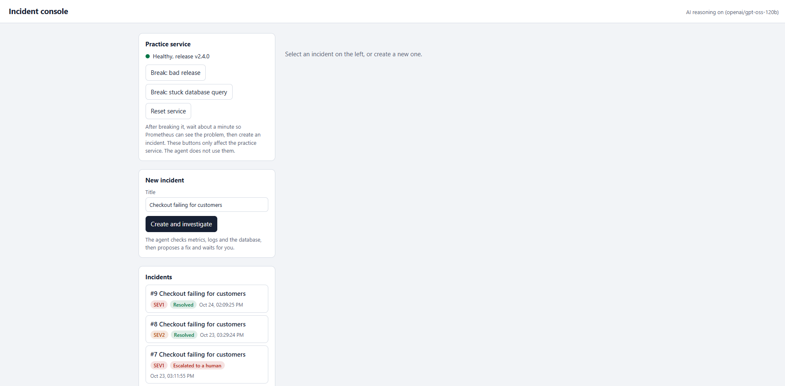
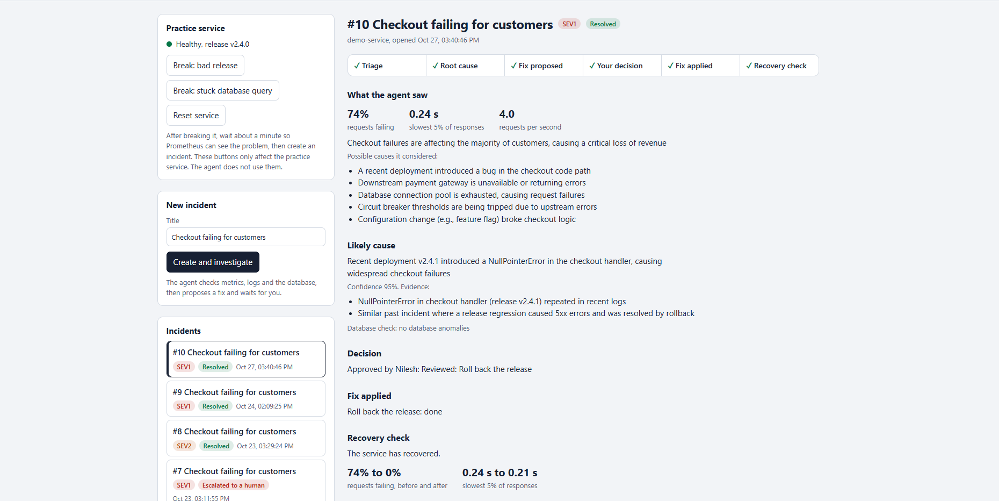
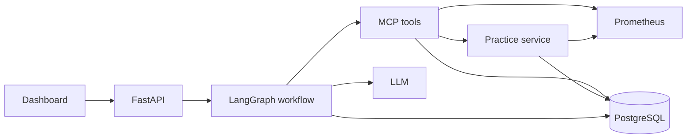
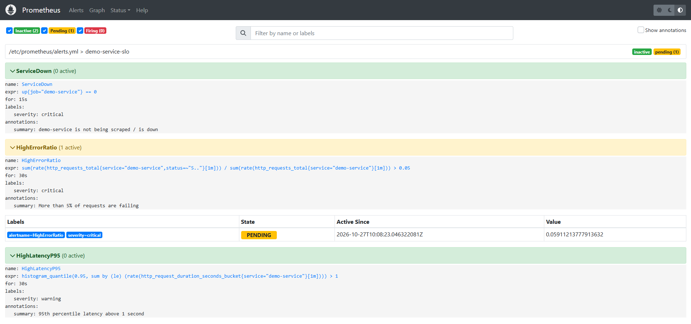
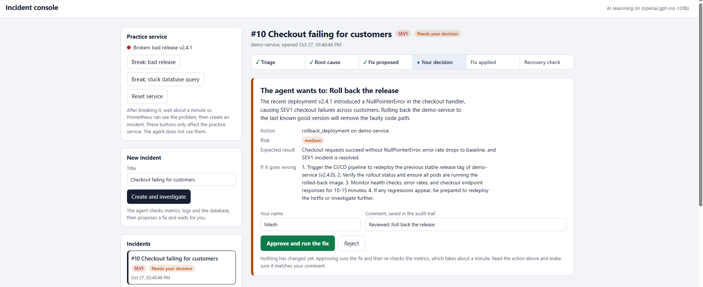
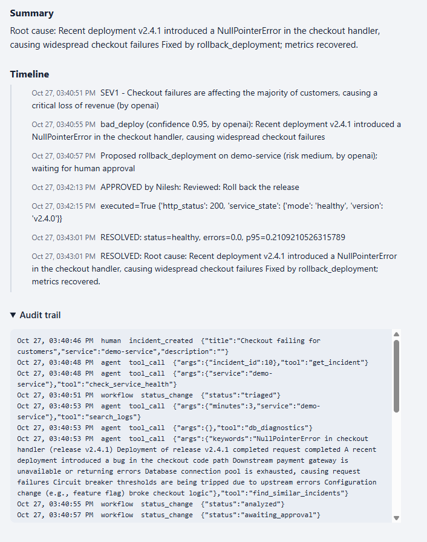
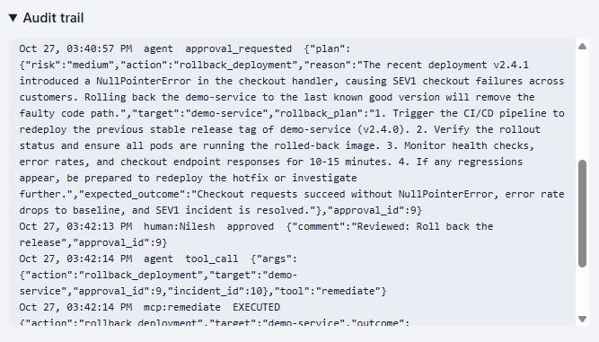
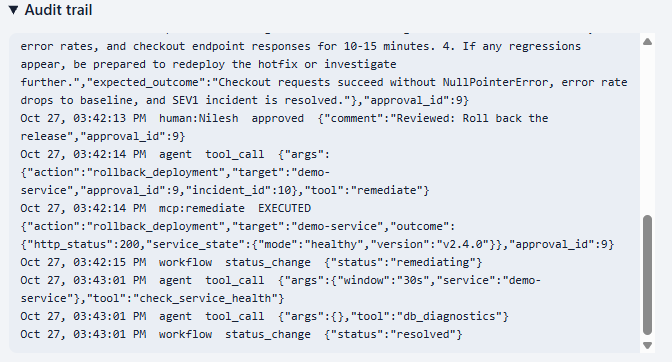

# AI SRE Incident Response Agent

When a service breaks, an on-call engineer has to check the metrics, read the logs, look at the database, decide on a fix, apply it, and confirm it worked. This project is a prototype that does the investigation part with an AI model and leaves the decision to a person.

I built it as a learning project, with help from an AI assistant, and it runs against a practice service that I can break on purpose. It is not connected to any real production system.




## What it does

1. Triage: reads error rate, latency and traffic from Prometheus and gives the incident a severity from SEV1 to SEV4.
2. Root cause: searches recent logs, checks the database, and looks up similar past incidents.
3. Plan: proposes one fix from a short approved list, with its risk and a fallback.
4. Approval: the workflow stops and waits until a person approves or rejects the plan.
5. Fix: runs the approved action through a guarded tool.
6. Verify: waits, checks Prometheus again, and only reports success if the numbers recovered.

Every step is saved in PostgreSQL, including who approved what and when.

## How it fits together



The workflow runs in this order: triage, root cause, plan, human approval, execute, verify, report. If the person rejects the plan, it skips straight to the report and the incident is marked as escalated.

## The practice service

There is a small fake checkout service in `demo_service/` that writes logs, exposes Prometheus metrics, and can fail in two ways:

- Bad release: many requests fail with errors, but responses stay fast. The right fix is a rollback.
- Stuck database query: responses get very slow and the logs show lock timeouts. A real long-running query shows up in PostgreSQL. The right fix is to end that query.

A plain restart does not fix either one, which is why the root cause step matters.

## The tools the agent can use

The agent only touches the system through six MCP tools:

- search_logs: recent log counts and messages for a service
- check_service_health: Prometheus queries for availability, request rate, error ratio and p95 latency
- db_diagnostics: connections, long-running queries, lock waits
- get_incident: reads the incident record
- find_similar_incidents: searches a small knowledge base of past incidents
- remediate: runs one allowed fix, but only if a human approval exists for that exact action

## Safety

- Only three actions are allowed, each on a fixed target. The list is in `app/config.py`, and the model's choice is checked against it in code.
- The remediate tool looks in the database for a human approval of that exact action. An approval can only be used once.
- If the database shows a stuck query, the model cannot talk its way past that using older logs.
- Success is decided from fresh Prometheus numbers, not from what the model says.
- Everything is written to an append-only audit log.
- With no API key, or if the AI call fails, the agent falls back to simple built-in rules and says so in the timeline.

## Running it

You need Docker Desktop. You do not need to install Python.

```
git clone https://github.com/YOUR-USERNAME/ai-sre-incident-agent.git
cd ai-sre-incident-agent
cp .env.example .env
docker compose up --build
```

On Windows PowerShell, use `copy .env.example .env` instead of `cp`.

The first build takes a few minutes. When it is ready, open:

- http://localhost:8000/ for the dashboard
- http://localhost:8000/docs for the raw API
- http://localhost:8001/health for the practice service
- http://localhost:9090 for Prometheus

### AI model

Edit `.env` before starting. There are three options:

- Leave the key empty and the agent runs on built-in rules.
- Use a free Groq key: set OPENAI_API_KEY, set OPENAI_BASE_URL to `https://api.groq.com/openai/v1`, and set OPENAI_MODEL to a model your account can use.
- Use OpenAI: set OPENAI_API_KEY and OPENAI_MODEL, and leave OPENAI_BASE_URL empty.

After changing `.env`, stop with Ctrl+C and start again.

## Trying it out

1. Click Break: bad release in the dashboard and wait about a minute so Prometheus can see it.
2. Click Create and investigate.
3. Read the proposed fix, enter your name, and click Approve and run the fix.
4. After about a minute the incident should show Resolved, with the failure rate back to zero.
5. Open the audit trail at the bottom of the incident to see every step.

Then try Break: stuck database query, or reject a plan to see what an escalation looks like.

When the practice service breaks, Prometheus notices and fires an alert:









## Project layout

- `app/graph.py`: the LangGraph workflow and the approval pause
- `app/mcp_server.py`: the MCP tools
- `app/mcp_client.py`: connects the workflow to the tools and logs each call
- `app/main.py`: FastAPI endpoints and the dashboard route
- `app/dashboard.html`: the dashboard
- `app/llm.py` and `app/config.py`: the model wrapper, settings and the action allowlist
- `demo_service/main.py`: the practice service
- `db/init.sql`: database tables
- `prometheus/`: scrape config and alert rules

## Limitations

- It only works against the practice service. Real systems would need real integrations, such as Kubernetes or a cloud API.
- There is no login. Anyone who can open the dashboard can approve a fix.
- Incidents are created by hand. Prometheus alerts do not create them yet.
- Free AI models can be rate limited or retired. The agent then falls back to rules.
- The model sometimes adds small details that are not in the data, which is one reason a person approves every fix.

## What I would add next

- Create incidents automatically from Prometheus alerts
- Slack notifications with approve and reject buttons
- Login and roles
- More tools and more failure scenarios
- Automated tests

## License

MIT